# NoMercy Share

NoMercy Share puts a small floating bar on your Windows desktop. Click a button, and a screenshot, a screen recording or a picture of a web page is saved, uploaded to a host you choose, and the link is on your clipboard. Paste it into a chat and the other person sees the picture.

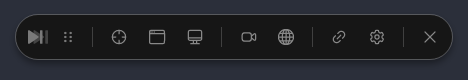

## Before you start

- NoMercy Share runs on Windows. Other systems print a message and exit.
- There is no installer yet. You run it from source, which needs the [.NET 10 SDK](https://dotnet.microsoft.com/download):

  ```
  dotnet run --project src/NoMercy.Share.App
  ```

- Screen recording needs [ffmpeg](https://ffmpeg.org/download.html) on your PATH. Screenshots do not.
- Web page capture needs Microsoft Edge or Google Chrome. Windows ships with Edge.
- To get links instead of files, you need somewhere to upload to: a Cloudflare R2 or S3-compatible bucket, or a Discord channel webhook. See [Set up sharing](#set-up-sharing).

Until sharing is set up, nothing is uploaded. Every capture is saved in a `NoMercy Share` folder inside your Pictures folder, and the picture itself goes on the clipboard so you can still paste it.

## The bar

The bar floats above your other windows. Drag it by the handle on the left edge and it remembers where you left it. Every button has a tooltip, and Tab and Enter work if you prefer the keyboard.

From left to right: the handle, then **Capture a region**, **Capture a window**, **Capture the full screen**, **Record the screen**, **Capture a web page**, **Recent links**, **Settings** and **Close**.

After a capture the bar says what happened underneath it, for example "Link copied". A failed upload keeps the file on your PC and says why.

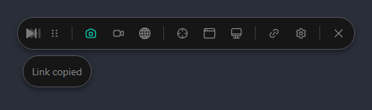

## Capture a region

Press `Win+Shift+S`, or click the crosshair button. The screen freezes and dims. Drag over the part you want, and the size shows beside the selection. Let go of the mouse button or press Enter to capture. Press Esc to cancel.

NoMercy Share takes over `Win+Shift+S` from the Snipping Tool. If you want Windows to have it back, clear that hotkey in [Settings](#settings).

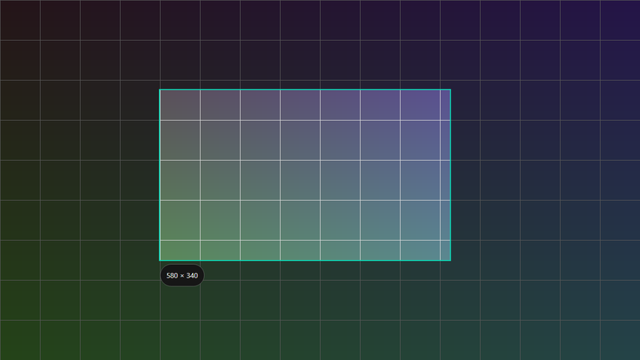

Each monitor keeps its own display scale, so a selection stays on one monitor.

## Capture a window or the full screen

**Capture a window** takes the window you were using before you clicked the bar. If there was none, it takes the window under the cursor. Windows that are partly covered by others still come out whole.

**Capture the full screen** takes the monitor your cursor is on.

The bar hides itself for a moment so it is not in the picture. Both buttons have hotkeys: `Alt+PrintScreen` for a window and `PrintScreen` for the full screen. Once the capture is shared, the bar shows the notice you saw above.

## Record the screen

Click the record button (or press `Shift+PrintScreen`), then drag over the part of the screen to record, the same way as for a region. Esc cancels. The bar shows a red dot and a running timer while it records.

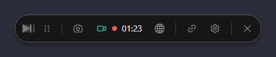

Click the button again to stop. The recording is squeezed into an MP4 that fits the size limit, 50 MB unless you change it, and shared like any other capture. A long recording is compressed harder to fit, so keep clips short if quality matters.

Sound is off until you turn it on. In [Settings](#settings), under Recording, switch on **Record system sound** for what your speakers play and **Record microphone** for your voice. If a microphone or sound output is missing, the recording still starts and the bar tells you what it left out.

## Capture a web page

Click the globe button. A small window asks for three things:

- **Address**: filled in for you when your clipboard holds an https address.
- **Mode**: **Full page**, **Visible area**, or **One element**, where you give a CSS selector such as `#header`.
- **Width**: **Desktop** or **Phone**, which decides how the page lays itself out.

Press Enter to capture or Esc to cancel.

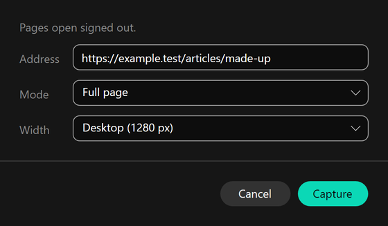

The page opens in a private, headless Edge (or Chrome) that is closed again afterwards. It has no cookies, so you see the page as a signed-out visitor, and only http and https addresses are opened.

## Capture from your browser

The browser extension for Edge and Chrome captures the tab you are looking at. It hands the picture to NoMercy Share, which shares it like any other capture. The extension is not on a browser store yet, so you load it from the repository. [Browser extension](docs/browser-extension.md) has the steps.

Click the extension's icon to open its popup.

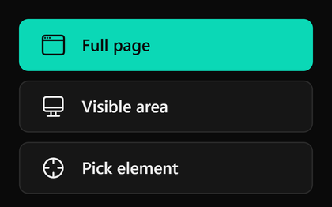

- **Full page** captures the whole page, however far it scrolls.
- **Visible area** captures what is on screen.
- **Pick element** lets you point at one part of the page. Move the mouse and the part under it is highlighted. Click to capture it, or press Esc to cancel.

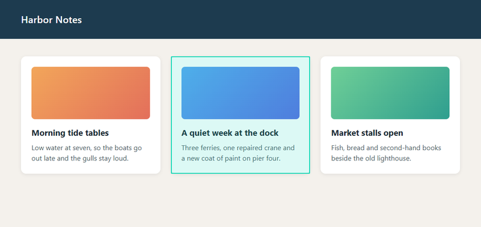

While Full page or Pick element works, the browser shows its own "started debugging" bar for a moment. That is the browser telling you the extension is controlling the tab. Browser pages, extension stores and local files cannot be captured.

## Recent links

Click the link button to see the links you shared lately, newest first. Each row shows when you shared it and when it expires. Use the copy button to copy a link again, or the arrow to open it in your browser. With a row selected, Enter copies its link and Esc closes the list.

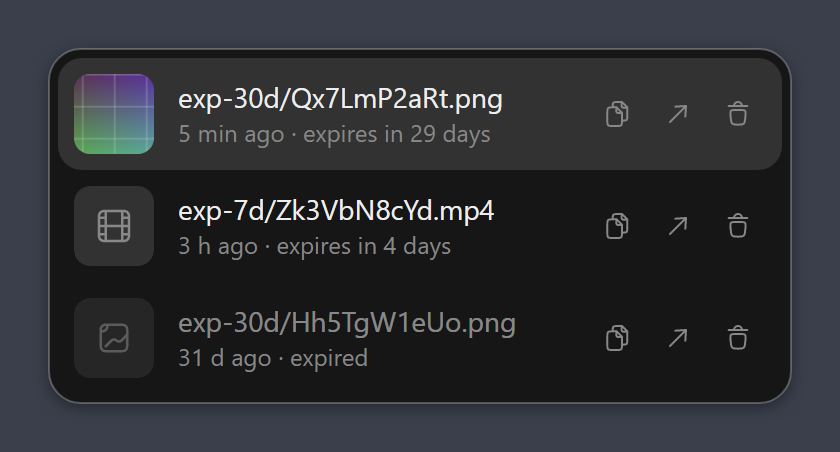

## Settings

The gear opens one window with four sections in the list on the left. Pick a section to see its page. **Save** checks every field and applies the change at once: the next share uses the new host, the next recording the new limits, and the hotkeys register again. **Cancel** changes nothing.

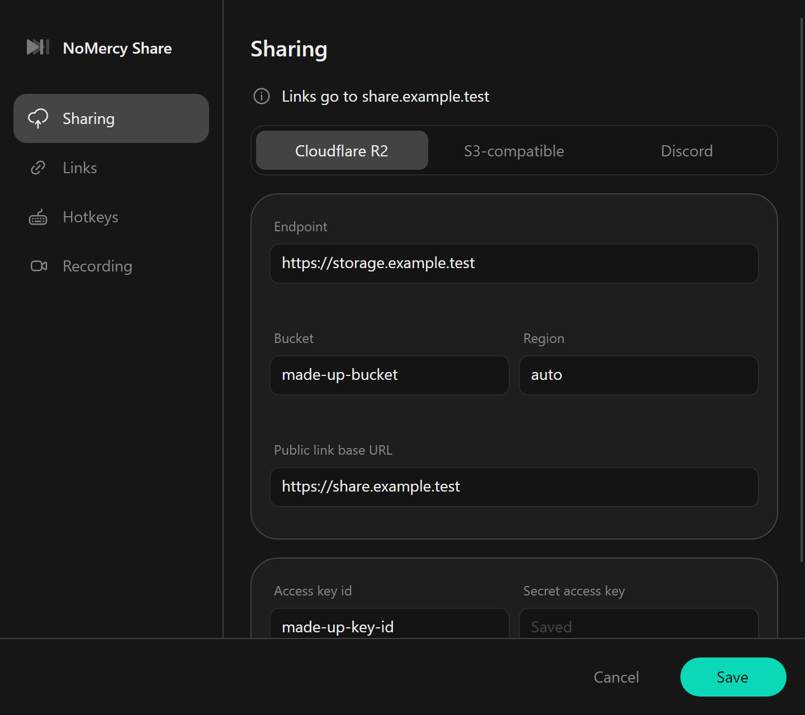

| Section | What you set |
| --- | --- |
| Sharing | Where uploads go: **Cloudflare R2**, **S3-compatible** or **Discord**. See [Set up sharing](#set-up-sharing). |
| Links | The default expiry: never, or 1, 7, 30 or 90 days. |
| Hotkeys | Click a field and press the keys you want. The cross turns that hotkey off. The defaults are `Win+Shift+S` (region), `PrintScreen` (full screen), `Alt+PrintScreen` (window) and `Shift+PrintScreen` (record). |
| Recording | The largest video to share, the frame rate, and the two sound switches. |

Your secret access key is stored in the Windows Credential Manager, never in a file. The box shows "Saved" afterwards and stays empty. Leave it empty and the stored key stays.

## Set up sharing

Pick the provider in Settings under Sharing.

**Cloudflare R2 or another S3-compatible host.** Fill in the endpoint, bucket, region, the public link base URL, and your access key id and secret. The public link base URL is the address your links start with, for example `https://share.example.test`. A link is that address plus a random name, so nobody can guess it. [Storage hosts](docs/storage-hosts.md) explains how the host expires links, which you set up once.

**Discord.** Choose Discord and paste a channel's webhook address. The file is posted to that channel and the Discord link goes on your clipboard. Discord decides how long its links work, and files are limited to 10 MB by default, so a larger recording is squeezed to fit.

## The link you share

A link opens a simple page with the picture, video or audio, an **Open original** button, a **Download** button, and a line saying how long the link works. Chat apps that preview links show the picture itself. Add `?raw=1` to a link to get the plain file.

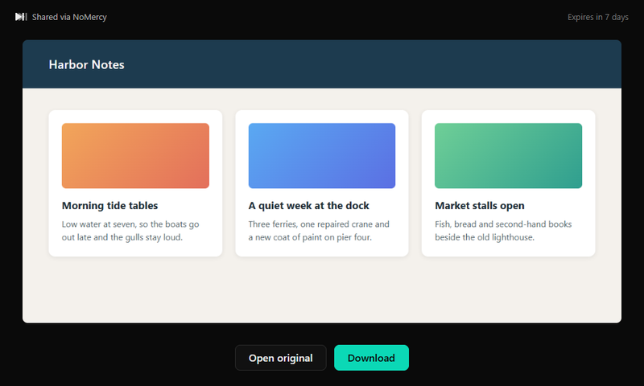

When a link has expired, the page says so calmly instead of showing an error. The page is served by the Cloudflare Worker in [`host/`](host/README.md), which you only need if you run your own host for these links.

## When Windows blocks saving

Windows can stop an app it does not know from saving in your Pictures folder (this is Controlled folder access). NoMercy Share then asks under the bar whether to allow itself. **Allow** makes Windows ask for administrator permission and, once you agree, captures are saved in your Pictures folder again. **Not now** hides the question until you restart the app. Meanwhile captures are saved to a `Captures` folder inside `NoMercy Share` in your local app data, so nothing is lost.

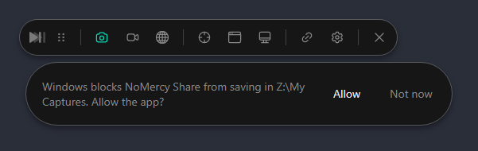

## More

- [Settings file](docs/settings-file.md): every option in `settings.json`, with its default.
- [Storage hosts](docs/storage-hosts.md): R2, S3 and Discord setup, expiry folders and credentials.
- [Browser extension](docs/browser-extension.md): build it, load it, what it may do.
- [Share page host](host/README.md): the Worker that serves links.
- [Development](docs/development.md): architecture, build, tests and how the screenshots here are made.

## License

MIT, NoMercy Labs.
