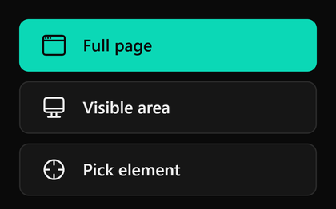

# Browser extension

The extension in `extension/` captures the open tab in Edge or Chrome and hands the picture to the NoMercy Share app, which shares it like any other capture. The link goes to the clipboard when the app has a share host set up. Without one the picture is saved on this PC and the popup names the file.

## Install

You need Node.js to build it.

1. In `extension/`, run `npm ci` and then `npm run build`.
2. Open `edge://extensions` (or `chrome://extensions`), turn on Developer mode, choose Load unpacked and pick `extension/dist`.
3. Start NoMercy Share once. It registers the native host for Edge and Chrome (current user only), which lets the extension start the app. Until then the popup says "Start NoMercy Share once so the browser can find it."

## What it can do

- **Full page** captures the whole page. Pages taller than 16384 CSS pixels are cut off there.
- **Visible area** captures what is on screen.
- **Pick element** highlights the part of the page under the mouse. Click it to capture it. Escape cancels, and so does Escape in the popup.

Browser pages, the extension stores and local files are refused.

## Permissions

The extension asks for `activeTab`, `scripting`, `nativeMessaging`, `debugger`, `clipboardWrite` and `contextMenus`, and for no host access. Full page and Pick element attach the browser debugger to the tab for the capture only, so the browser shows its "started debugging" bar for a moment.

The key in `extension/manifest-key.txt` fixes the extension id (`pffggmajnklhkjjgldpojacknecfkmlc`) that the app lists in the native host manifest.
